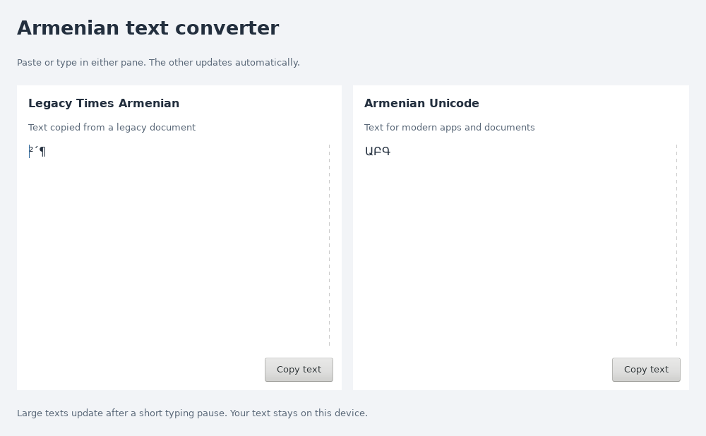

# Armenian Unicode Converter

A small wxWidgets desktop utility that converts pasted text between legacy Times Armenian character mappings and Armenian Unicode. Enter text on either side to update the other. Text up to 32 KiB updates live on the next UI tick. Larger text waits until typing has stopped for 750 ms, then processes 32 KiB chunks between UI events. Each new edit restarts the delay. Editing either pane replaces pending work; the opposite pane updates once conversion finishes, avoiding repeated full-text layout.



## What it converts

The left panel contains legacy character positions represented as UTF-8 text; the right contains Armenian Unicode. For example, legacy `²´¶` becomes `ԱԲԳ`. The mapping includes Armenian letters and selected punctuation, including the ellipsis.

This is not a general encoding detector or raw ANSI-file converter. It does not parse Word documents or repair every kind of mojibake. Both conversion functions accept UTF-8 byte strings. Unmapped sequences are preserved, but characters also used by the legacy mapping are interpreted as legacy symbols when converting toward Armenian. Keep a copy of your original text; punctuation mappings are not a guarantee of lossless round trips for arbitrary text.

To display the legacy side with Armenian glyphs, a compatible legacy font must be installed separately. Fonts are not bundled.

## Build and run

Requires CMake 3.16+, a C++17 compiler and wxWidgets development libraries (core, base and stc).

```sh
git clone https://github.com/senqx/ArmUnicodeConverter.git
cd ArmUnicodeConverter
cmake -S . -B build
cmake --build build
./build/arm_unicode_converter
```

On Debian/Ubuntu, the wxWidgets development package is commonly `libwxgtk3.2-dev`; on Arch Linux, `wxwidgets-gtk3`. Package names depend on your distribution.

## Validate the conversion library

The conversion library has no wxWidgets dependency:

```sh
cmake -S . -B build-tests -DARM_BUILD_GUI=OFF
cmake --build build-tests
ctest --test-dir build-tests --output-on-failure
```

Tests cover every mapping entry, ASCII, unrelated Unicode, truncated input sequences, 10 MB chunked/full conversion equivalence in both directions, and replacement of pending work. The conversion library is verified on Linux. A GUI integration executable is built when wxWidgets is enabled:

```sh
xvfb-run -a ./build/gui_tests
```

It exercises the actual text controls, delayed conversion, a 10 MB paste, rapid edits, opposite-pane cancellation and closing with pending work. Run it on an existing desktop without `xvfb-run` if preferred. To use a non-default wxWidgets installation, pass `-DwxWidgets_CONFIG_EXECUTABLE=/path/to/wx-config` to CMake.

## License

[MIT](LICENSE).

## Large text

A Linux GCC 15 optimized benchmark measured about 14 ms for 1 MB and 118 ms for 10 MB of mixed Armenian/Unicode text in the conversion library alone. These are local measurements, not a GUI responsiveness guarantee. Chunking keeps conversion from occupying the UI thread for the full document; reading input and replacing the final text still depend on the native widget and can pause on very large documents.

The GUI was built and tested with wxWidgets 3.1.5 on Linux and locally reviewed by the maintainer. The 10 MB GUI test completed in approximately 2.1 seconds, including the 750 ms typing delay and final display update. Large documents use wxWidgets’ Scintilla editor control without line wrapping.
